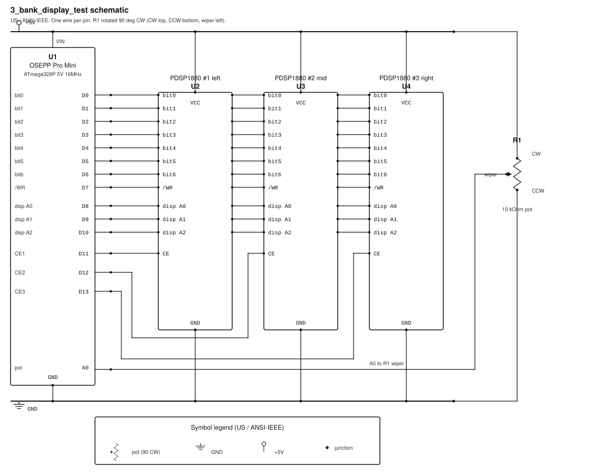

# 3_bank_display_test

**Status:** Final release **v1.0.0** -- original 2013 sketch, closed out.

**Project page:** https://k9dtv.com/project-3-bank-display.html  
**Sister project (structured rewrite):** [new_3_bank_display_test](https://github.com/K9DTV/new_3_bank_display_test) -- same hardware and scroll behavior; clearer code and a fixed 20..500 ms pot delay range.

*Breadboard prototype: three PDSP1880 LED character displays, MCU on the right, multi-turn pot for scroll speed.*

Sketch file: `Three_bank_display_test` -- written by Jim Burney, 07/08/2013.

## Overview

This program drives **three PDSP1880** LED character displays from an **OSEPP Pro Mini** (Atmel ATmega328 at **5 V**, **16 MHz**). The three modules are wired as one master and two slaves so they act as one long chain of digit positions.

The firmware walks the full displayable ASCII set (`TotalDisChar = 0x7F`) across every digit. Characters are written **left to right**: `DisPosCount` advances until `TotalDig` is reached, then the run returns to the leftmost digit and the character index advances by one. That continues until `TotalDisChar + TotalDig - 1` is reached.

Conditional math between `Char2Count` and `Char2Dis` corrects for the offset caused by writing left-to-right across `TotalDig` positions. Extra wrap math at the end of the character set makes the sequence roll from the last glyph back to the first so the chain never stops with a hard edge.

Scroll speed comes from analog pin **A0** (pot wiper). The ADC reading is scaled with `map()` into a delay `Timeinms` between **20 ms** and **500 ms**. At shorter delays the full ASCII run looks like the character set is scrolling **right to left**.

## Hardware

| Item | Detail |
|------|--------|
| MCU | OSEPP Pro Mini — ATmega328 @ 5 V, 16 MHz |
| Displays | 3× PDSP1880 (left master + two slaves) |
| Scroll control | Potentiometer wiper on **A0** (CCW = GND, CW = +5 V; sketch notes a 10 kΩ ten-turn) |
| Power | +5 V (`VIN`) and GND to the Pro Mini and all three displays |

## How the firmware works

### Setup

`setup()` sets **Port D** and **Port B** as outputs (`DDRD` / `DDRB` = `0xFF`), then loads Port D with ASCII space (`0x20`) so the displays power up blank instead of showing garbage.

### Main loop

Each pass of `loop()`:

1. Adjusts `Char2Count` if it has already walked past `TotalDig` (offset after the first full pass across the chain).
2. For every digit position `DisPosCount` from `0` through `TotalDig` (`0x17` = 23):
   - Holds **/WR** idle high (`DisIdle | Char2Dis`) so nothing is written while the next glyph is prepared.
   - Computes `Char2Dis` from `Char2Count`, wrapping when the count passes `TotalDisChar`.
   - Advances `Char2Count`, or resets it to `0` at the end of the wrap window.
   - Reads the pot on **A0** and updates `Timeinms` (`ScrMin`…`ScrMax`).
   - Selects the bank (left / mid / right module) from `DisPosCount`.
   - Writes bank + digit address on **Port B**, then pulses the character out on **Port D** with **/WR** low (`DisWR | Char2Dis`).
3. After all digits are updated, `delay(Timeinms)` sets how long that frame holds before the next character step.

### Bank select

| Digit positions | `Bank` value | Module |
|-----------------|--------------|--------|
| 0–7 | `0xF0` | Left (bank 1, D11) |
| 8–15 | `0xE8` | Middle (bank 2, D12) |
| 16–23 | `0xD8` | Right (bank 3, D13) |

`PORTB = Bank | DisPosCount` combines chip-enable bits with the digit address on **A0–A2** (D8–D10).

## Schematic

Shared **bit0–bit6**, **/WR**, and **disp A0–A2** go to all three PDSP1880 modules. **D11 / D12 / D13** are individual bank selects (CE1–CE3). The pot wiper goes to **A0**.

## Pin map

From the sketch header. Port **D** is character data and write; Port **B** is digit address and bank select.

| Pro Mini | Port | Chip pin # | Function |
|----------|------|------------|----------|
| D0 (RX0) | PD0 | 30 | Display bit 0 |
| D1 (TX1) | PD1 | 31 | Display bit 1 |
| D2 | PD2 | 32 | Display bit 2 |
| D3 | PD3 | 1 | Display bit 3 |
| D4 | PD4 | 2 | Display bit 4 |
| D5 | PD5 | 9 | Display bit 5 |
| D6 | PD6 | 10 | Display bit 6 |
| D7 | PD7 | 11 | Display write (active low) |
| D8 | PB0 | 12 | Display A0 |
| D9 | PB1 | 13 | Display A1 |
| D10 | PB2 | 14 | Display A2 |
| D11 | PB3 | 15 | Bank select 1 (left) |
| D12 | PB4 | 16 | Bank select 2 (middle) |
| D13 | PB5 | 17 | Bank select 3 (right) |
| A0 | PC0 | 23 | Scroll-speed pot wiper |
| VIN | — | — | +5 V |
| GND | — | — | Ground |
| RST | — | — | Reset |
| NC | — | — | No connection |

## Build and upload

1. Open `Three_bank_display_test` in the Arduino IDE (no external libraries).
2. Board: **Arduino Pro or Pro Mini**, processor **ATmega328P (5 V, 16 MHz)**.
3. Wire as in the schematic / pin map above.
4. Upload and turn the pot to adjust scroll speed.

GitHub Actions compiles this sketch on every push to `master` (compile check only; does not upload to the board).

## License

See `LICENSE` (MIT).
